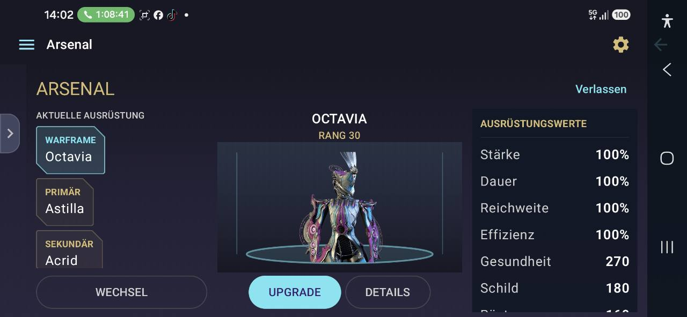
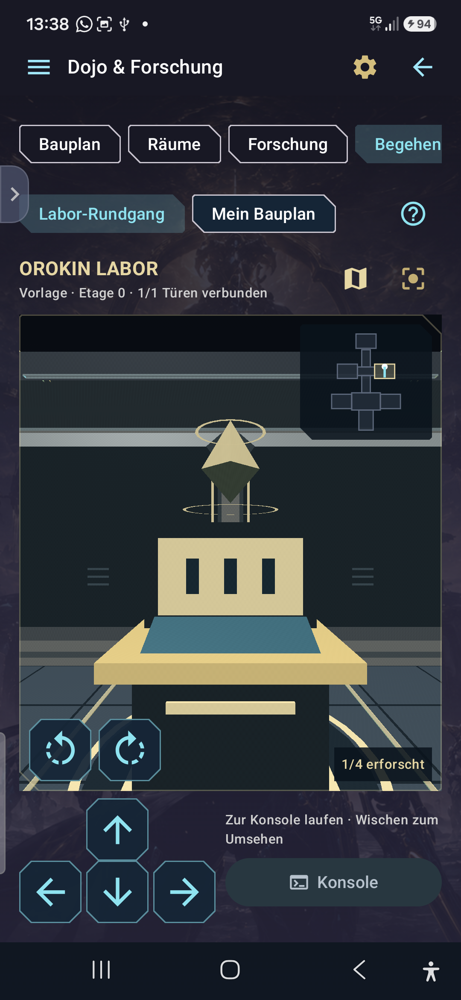
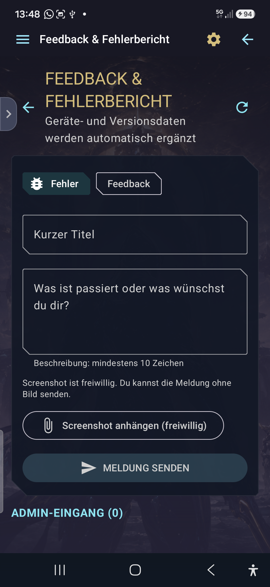

# TennoFreunde – Anleitung & App-Einblicke

Deine Warframe-Sammlung, Ausrüstung und nächsten Ziele auf Android: TennoFreunde verbindet Live-Status, Screenshot-Scanner, Sammlung, Arsenal, virtuelle Schmiede und Planung mit einer optionalen Cloud-Sicherung.

**Dokumentationsstand: 10.10.2026 · Entwicklung bis 11.90 · Android 7 oder neuer.** Die aktuell veröffentlichte Version ist **11.85**. Die unten ausdrücklich markierten Neuerungen ab 11.86 sind vorbereitet, aber noch nicht als neues Release veröffentlicht.

[Aktuelle APK herunterladen](https://github.com/hahawasistlos1/TennoFreunde/releases/latest) · [Alle Versionen und Update-Hinweise](https://github.com/hahawasistlos1/TennoFreunde/releases)

## Schnellstart

1. Öffne die Release-Seite und lade dort die APK herunter. Bestätige die Installation im Android-Systemfenster.
2. Wähle in **Einstellungen** Sprache und Darstellung. Ein TennoFreunde-Konto ist optional.
3. Wähle auf der Live-Seite deine Plattform, beispielsweise PS4/PS5.
4. Pflege Besitz-Haken in **Sammlung**, oder scanne Inventar-Screenshots und prüfe die erkannten Treffer.
5. Erstelle unter **Exportieren** eine Sicherung. Ab 11.87 findest du Export, Import, A–Z-Sortierung und Profil-Einlesen in **Einstellungen → Sammlung & Daten**.

**Ab 11.90:** Eine freiwillige Kurzanleitung wird einmal angeboten. Du kannst sie lesen oder überspringen und später unter **Einstellungen → App-Info → Kurzanleitung öffnen** erneut aufrufen. Updates und Profilwechsel wiederholen das Angebot nicht.

## Orientierung in der App

Das Seitenmenü öffnet die Hauptbereiche. Die Android-Zurück-Taste schließt zunächst Dialoge und führt aus Unterseiten zurück. Lange Inhaltsseiten lassen sich scrollen; Karte, Dojo-Kamera und Arsenal im Querformat haben eigene Bedienflächen.

**Ab 11.87** bündelt **Orbiter** diese neun Bereiche: Arsenal, Schmiede, Sternenkarte, Mods, Arkanas, Relikte, Inkubator, Helminth und Talentbäume. Zurück führt aus diesen Bereichen zuerst zur Orbiter-Übersicht. In 11.85 findest du die vorhandenen Bereiche noch über das bisherige Seitenmenü.

| Bereich | Wofür du ihn nutzt |
| --- | --- |
| Übersicht / Live | Weltzyklen, Eidolon-Nacht, Risse, Ereignisse und Baro |
| Tenno-Zentrale | Farm-Ziele, Favoriten, Fortschritt und Planer |
| Sammlung | Dauerhafter Besitz- und Abschlussfortschritt |
| Screenshot-Scanner | Inventarbilder erkennen und Treffer übernehmen |
| Orbiter, ab 11.87 | Einstieg zu Ausrüstung und Orbiter-Systemen |
| Konto & Cloud | Optionale Anmeldung, Synchronisierung und Wiederherstellung |
| Feedback / Fehlerbericht | Ideen, Bugs und freiwillige Screenshot-Anhänge |
| Einstellungen | Darstellung, Sprache, Benachrichtigungen, Sicherungen und Diagnose |

## Live-Status & Eidolon

Die Übersicht zeigt Weltzyklen, Void-Risse, Invasionen, Sortie, Ereignisse, Neuigkeiten und Baro Ki’Teer, soweit die Datenquelle sie liefert. Gespeicherte Daten bleiben auch offline lesbar. Öffne eine Karte für Einzelheiten.

**Ab 11.88** zeigt die Cetus-Karte Tag oder Nacht ausdrücklich an, mit Sonne beziehungsweise Mond und Countdown bis zum nächsten Wechsel. Abgelaufene oder unbekannte Daten werden nicht als verlässliche aktuelle Phase dargestellt.

**Ab 11.89** stehen zwei Auswahlbuttons nebeneinander: **Plattform** und **Anzeige / Intervall**. Wähle PS4/PS5, PC, Xbox, Switch, iOS oder Android sowie „Relevant für mich“ und 1, 2 oder 5 Minuten. Die Auswahl wird gespeichert. Buttons und Karten geben beim Drücken eine sichtbare Rückmeldung.

## Sammlung, Inventar & Farm-Plan

**Sammlung = dein dauerhafter Fortschritt. Inventar = dein aktueller Bestand.** Wenn du einen Gegenstand später verkaufst, darf sein Inventarbestand sinken; ein bereits abgeschlossener Sammlungseintrag bleibt abgeschlossen.

Suche in Kategorien, hake Gegenstände und Bestandteile ab, setze Favoriten und plane fehlende Materialien in der Tenno-Zentrale. Bestätigte positive Treffer aus Scanner, Profil oder Inventarimport können passende Sammlungseinträge ergänzen. Sie entfernen keine bestehenden manuellen Haken.

Tabs, Untertabs und andere unterstützte Bereiche lassen sich über ihre Verschiebegriffe per Drag-and-drop anordnen. Die persönliche Reihenfolge bleibt gespeichert, auch nach Updates; neue Funktionen ergänzen die vorhandene Anordnung. Verwaltungsbuttons sind je nach Rolle sichtbar.

## Screenshot-Scanner

1. Öffne den Scanner und wähle Android-, PS4- oder PS5-Inventarbilder aus. Lokal gespeicherte Bilder kannst du auch über **Teilen → TennoFreunde** übergeben.
2. Die Warteschlange arbeitet mehrere Bilder nacheinander ab. Für viele Bilder kannst du einen eigenen Scan-Ordner auswählen.
3. Prüfe die erkannten Namen und Kategorien. OCR kann besonders bei dunklen, abgeschnittenen oder kleinen Beschriftungen falsch liegen.
4. Übernimm die bestätigten Treffer. Ein vorhandener Besitz-Haken wird nicht erneut verändert.

Offizielle, eindeutig zugeordnete Katalogtreffer können gesammelt übernommen werden. Unsichere und unbekannte Namen benötigen Prüfung. Neue Einträge werden nur dann passend eingeordnet, wenn die Zuordnung eindeutig ist. Verarbeitete Ordnerdateien werden gemerkt; vorbereitete Hintergrundaufträge und ihre Anzeige hängen auch von Androids Hintergrundfreigaben ab.

## Arsenal & Mods einsetzen

Wähle in der Ausrüstungsübersicht Warframe, Primär-, Sekundär- oder Nahkampfwaffe sowie Begleiter und Begleiterwaffe. **Wechsel** öffnet die Auswahl; **Upgrade** öffnet die Mod-Konfiguration. Das Arsenal nutzt eine Ansicht im Querformat.

*Echte App-Aufnahme eines früheren Teststands. Ausrüstung und Werte sind Beispieldaten; die aktuelle Darstellung kann abweichen.*

- Konfigurationen A, B und C werden für die Ausrüstung gespeichert.
- Passende Mods können ausgewählt oder per Drag-and-drop in Slots gezogen werden. Warframes bekommen keine Waffen-Mods angeboten.
- Filter helfen bei Alle, Aura, Augment, Exilus und den jeweiligen Polaritäten.
- Slot-Polaritäten stehen an den Slots und lassen sich dort bearbeiten. Mod-Karten zeigen ihre Polarität ebenfalls.
- Derselbe Mod-Typ lässt sich nicht mehrfach in derselben Konfiguration einsetzen. Bereits eingesetzte Mods werden aus der verfügbaren Auswahl ausgeblendet, bis du sie entfernst.
- Kapazität, Rang, Polaritäten und unterstützte Reaktor-/Katalysator-, Exilus- und Forma-Angaben fließen in die Planung ein.

**Die App verändert deine echte Warframe-Ausrüstung nicht.** Werte und Ausbauinformationen sind Planungshilfen; Sonderfälle können noch nicht vollständig berechnet werden.

## Eigener Mod-Bereich, ab 11.86

Hier siehst du deine besessenen Mods mit Mengen. Über die Ansicht für fehlende Mods erscheinen nicht besessene Karten abgedunkelt. Suche und Detailansichten helfen beim Finden und Vergleichen.

Eine Menge ist nur so genau wie die Datenquelle: Ein Besitz-Haken oder Screenshot kann eine Mindestmenge bestätigen, aber keine vollständige Anzahl beweisen. Unbestätigte Mengen bleiben entsprechend als Mindestmenge oder unbekannt erkennbar. Verschiedene bestätigte Exemplare und Ränge werden bei der Bestandsübersicht berücksichtigt.

## Virtuelle Schmiede

Die Schmiede ist ein eigener Bereich. Die Filter **Alle**, **Baubereit**, **In Herstellung** und **Fertig** trennen Baupläne und Aufträge. Auf Übersichtskarten siehst du Besitz und Meisterschaft, soweit diese bestätigt sind.

Öffne einen Bauplan für Komponenten, Ressourcen, Blaupausen und Bauzeit. Fehlende Materialien können in die Farm-Planung übernommen werden. In **In Herstellung** stehen laufende Timer; nach ihrem Ablauf erscheinen die Aufträge unter **Fertig**. Fertige persönliche Aufträge kannst du über **Abholen** direkt auf der Karte abschließen.

Ein App-Timer soll parallel zu deinem echten Bau laufen. **Starten und Abholen in TennoFreunde führen keine Aktion im Spiel aus.** Importierte Bauaufträge werden nur verarbeitet, wenn entsprechende Daten vorhanden sind. Kubrows und Kavats gehören in den Inkubator, nicht als gewöhnliche Baupläne in die Schmiede.

## Sternenkarte, Händler & Dojo

Öffne Planeten und Missionsknoten für Verbindungen, Missionstyp, Fraktion und weitere bekannte Angaben. Die Missionskarte lässt sich verschieben und zoomen. Normal- und Stahl-Pfad-Fortschritt werden getrennt gepflegt; unbekannter Fortschritt wird nicht geraten.

Händler sind ihren Orten zugeordnet: Öffne beispielsweise **Erde → Cetus**, um die dortigen Händler aufzurufen. Relais, Zariman und weitere Orte bieten ihre zugehörigen Händleransichten. Angebote und Live-Rotationen hängen von den verfügbaren Daten ab und können sich im Spiel ändern.

Das Dojo erreichst du über die Sternenkarte. Neben Bauplan, Räumen und Forschung gibt es **Begehen → Labor-Rundgang**: Laufe mit den Pfeilen durch die selbst gestaltete 3D-Ansicht, sieh dich um und öffne erreichbare Labor-Konsolen.

*Labor-Rundgang aus Version 11.81. Die selbst gestaltete Ansicht ist eine Planungshilfe und keine Verbindung zu deinem echten Dojo.*

Clan-Stufe und Forschung helfen bei der Kostenplanung. Persönliche Ressourcen und Clan-Beiträge bleiben getrennt. Forschungszustände und Raumpläne werden profilbezogen gespeichert.

## Arkanas, Relikte, Inkubator, Helminth & Talentbäume

Diese Bereiche ergänzen Sammlung und Ausrüstung:

| Bereich | Inhalt |
| --- | --- |
| Arkanas | Katalog, Bestände und persönlicher Fortschritt |
| Relikte | Reliktvarianten und Bestandsverwaltung |
| Inkubator | Begleiter- und Zuchtplanung, insbesondere Kubrows und Kavats |
| Helminth | Übersicht und manuell gepflegter Fortschritt |
| Talentbäume | Fokus-Schulen und Intrinsics zur persönlichen Planung |

Die Inhalte lassen sich scrollen. Diese Planungsbereiche können manuell gepflegt werden; eine automatische Übernahme sämtlicher Spielwerte, vollständige Zuchtberechnungen oder das Freischalten von Talenten im Spiel sind nicht zugesichert.

## Konto, Cloud, Profil & Inventarimport

Ein **TennoFreunde-Konto ist kein Warframe-Konto**. Die App funktioniert auch ohne Anmeldung. Die Cloud dient dem App-Fortschritt und der optionalen Synchronisierung. Prüfe Wiederherstellungsvorschauen, bevor du Daten übernimmst.

Unter **Einstellungen → Sammlung & Daten**, ab 11.87, findest du Export, Import, A–Z-Sortierung und Warframe-Profil-Einlesen. Ein Profilimport liefert nur die dort enthaltenen bestätigten Informationen, kein garantiert vollständiges Live-Inventar.

Der optionale experimentelle `inventory.json`-Import zeigt vor Übernahme eine Differenzvorschau. Nur ein vollständig validierter Snapshot darf aktuelle Mengen reduzieren. Fehlende Sektionen bedeuten niemals automatisch null; eine fehlende optionale `PendingRecipes`-Sektion bedeutet nicht „keine laufenden Aufträge“. Unvollständige Dateien oder auffällige Rückgänge werden abgelehnt. Die importierte Rohdatei wird nach der Normalisierung nicht dauerhaft gespeichert.

**Windows-Helfer:** Die Kopplung ist optional. Ein vollständiger Echtlauf mit dem aktuellen Warframe-Client ist bisher nicht bestätigt; eine verlässliche Datenquelle wird noch untersucht. Wiederholte Spielneustarts sind keine garantierte Lösung, und ein fehlender vollständiger Snapshot erzeugt keine Inventardatei. Die App bleibt mit manueller Eingabe, Scanner und Profilimport nutzbar. Ein read-only Prozessspeicherzugriff ist von Digital Extremes nicht ausdrücklich freigegeben; es werden keine Warframe-Passwörter oder Auth-Tokens benötigt.

## Einstellungen & Benachrichtigungen

Stelle Sprache, Farbschema, Textgröße, kompakten Modus, Offline-Modus und Benachrichtigungen ein. Einstellungsgruppen lassen sich ein- und ausklappen. Unterstützte Bereiche können persönlich angeordnet werden.

Benachrichtigungen können auf neue Versionen, Baro, die Eidolon-Nacht, fertige persönliche Schmiedeaufträge und Sicherungen hinweisen. Android muss die jeweiligen Benachrichtigungen erlauben. Prüfe bei fehlenden Meldungen **Android-Einstellungen → Apps → TennoFreunde → Benachrichtigungen**.

## Feedback & Fehlerbericht

Wähle **Fehler** oder **Feedback**, trage einen Titel und eine nachvollziehbare Beschreibung ein und sende die Meldung. Beschreibe bei Fehlern möglichst, welche Seite und welche Schritte zum Problem geführt haben. **Ein Screenshot ist freiwillig.**

*Aufnahme aus Version 11.82. Der Admin-Eingang unten ist nur für entsprechend berechtigte Konten sichtbar.*

Die App ergänzt relevante Angaben wie App-Version, Android-Version und Gerätemodell. Automatische Absturzberichte helfen auch bei Fehlern, bei denen die App sofort schließt. Admins können eingehende Meldungen verwalten; Moderator- und Benutzerrechte richten sich nach der vergebenen Rolle.

## Installation & Updates

Lade die APK aus den [offiziellen Releases dieses Projekts](https://github.com/hahawasistlos1/TennoFreunde/releases/latest). Ein Update sollte über die bestehende Installation installiert werden, damit lokale Daten erhalten bleiben. Android kann verlangen, die Installation aus deinem Browser oder Dateimanager zu erlauben.

Die App kann Updates herunterladen und das Systemfenster zur Installation öffnen. **Eine Bestätigung durch Android kann weiterhin erforderlich sein; eine vollständig stille Installation wird nicht versprochen.** Die zwischengespeicherte Update-APK wird nach erfolgreicher Installation beim nächsten App-Start aufgeräumt. Der Update-Dialog zeigt weiterhin die Änderungsinformationen.

Für neue stabile GitHub-Releases mit APK ist die Firebase-Update-Benachrichtigung wieder vorbereitet. Die technische Verbindung wurde erfolgreich validiert; die tatsächliche Zustellung beim nächsten neuen Release muss noch auf einem Gerät geprüft werden. Benachrichtigungsrechte und Internetverbindung bleiben erforderlich.

## Hilfe bei Problemen

| Problem | Was du prüfen kannst |
| --- | --- |
| Scanner findet nichts | Bilder lokal herunterladen, lesbare Beschriftungen prüfen, Treffer nicht ungeprüft übernehmen |
| Warteschlange reagiert langsam | Verarbeitung großer Mengen abwarten; bei erneutem Hängen Anzahl und Zeitpunkt im Fehlerbericht nennen |
| Sammlung wirkt leer | Aktives Profil, Suche und Filter prüfen; Cloud-Daten nicht vorschnell löschen; Sicherung und Wiederherstellungsvorschau kontrollieren |
| Cloud-Sync schlägt fehl | Anmeldung und Verbindung prüfen, erneut versuchen, zusätzlich lokal exportieren |
| App schließt sofort | Aktuelles veröffentlichtes Update installieren; falls möglich einen Fehlerbericht mit Versionsangabe senden |
| APK lässt sich nicht aktualisieren | Installationsfreigabe und Herkunft prüfen; bei abweichender Signatur vor jeder Deinstallation unbedingt exportieren |
| Windows-Helfer findet keine Datei | Ein vollständiger aktueller Snapshot ist nicht garantiert verfügbar; Code 4 nicht mit erfolgreichem Sync verwechseln |

## Sicherung & Datenschutz

Exportiere regelmäßig und bewahre die Sicherung außerhalb des App-Ordners auf. Vor Deinstallation oder Gerätewechsel erst exportieren; nach Import oder Cloud-Wiederherstellung die Vorschau kontrollieren.

Fortschritt liegt lokal und bei Nutzung der Cloud im zugehörigen Firebase-Projekt. Feedback enthält deine eingegebenen Texte, gegebenenfalls freiwillige Bilder und Gerätedaten. Teile keine Passwörter, Kopplungsgeheimnisse oder Warframe-Sitzungsdaten in Fehlerberichten.

TennoFreunde ist ein unabhängiges Begleitprojekt und kein offizieller Warframe-Client. Datenquellen können unvollständig oder zeitlich verzögert sein. Die Screenshots zeigen echte frühere App-Teststände; Inhalte, Rollen und Navigation können je nach Version abweichen.
